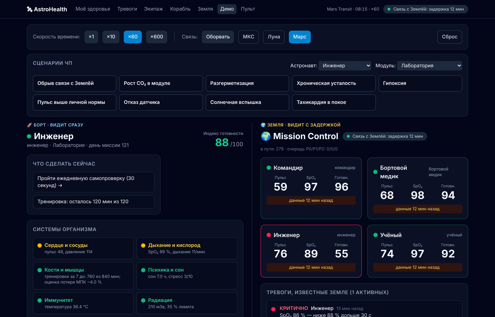
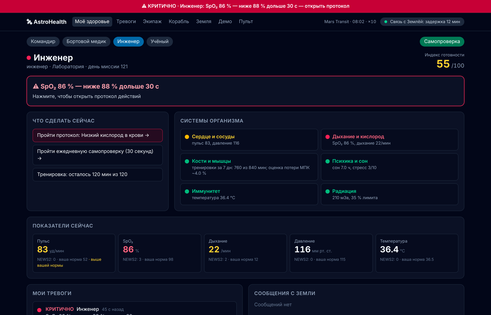
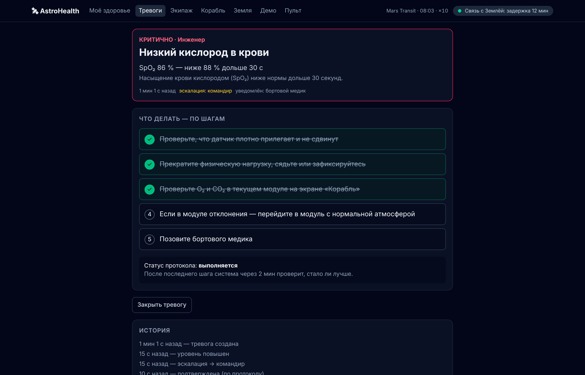

# AstroHealth — мониторинг здоровья астронавтов

Хакатонный проект: бортовая система, которая собирает показатели здоровья экипажа, помогает **самому астронавту** оценить своё состояние и подсказывает, **что делать прямо сейчас** — не дожидаясь Земли.

## Задача

> Long-duration missions expose astronauts to space radiation, isolation and confinement, altered gravity, and a hostile closed environment, which can bring immune changes, bone loss, cardiovascular events, and behavioral health problems. On long missions, astronauts carry much of the responsibility for spotting these changes in themselves. Your challenge is to build a health monitoring software that gathers health indicators and enables astronauts to evaluate and act on the status of their health.

| Что просят | Что делаем |
|---|---|
| **Gather** — собирать показатели | Датчики (симуляция), среда корабля, ежедневный опросник, дневник симптомов, журнал тренировок |
| **Evaluate** — оценить состояние | Статус по системам организма, NEWS2, личная норма, тренды, индекс готовности, объяснение каждой тревоги |
| **Act** — действовать | Пошаговый протокол к каждой тревоге, ежедневные советы, перепроверка показателя после действия |

## Почему это важно

- До Марса сигнал идёт **3–22 минуты** в одну сторону; раз в ~26 месяцев связи нет почти две недели.
- В 2020 году астронавта МКС с тромбом лечили по указаниям с Земли — на Марсе так не получится.
- Поэтому оценка и первые действия должны происходить **на борту**.

## Как устроен прототип

```
Simulator → Analytics → Alerts → Guidance → Onboard State ──WS──▶ экраны борта (/me, /alerts, /crew)
                                                 │
                                                 ▼
                                   Outbox + Link Simulator (задержка, обрывы, приоритеты)
                                                 │
                                                 ▼
                                           Ground State ──WS──▶ Mission Control (/ground)

SimClock — общие часы миссии (ускорение ×1…×600)        Пульт /director — сценарии ЧП
```

Реальных датчиков нет: **симулятор генерирует правдоподобные (мок) данные** для 4 астронавтов, а пульт сценариев запускает ЧП — гипоксию, рост CO₂, обрыв связи и т. д.

Подробнее — в [`docs/architecture.md`](docs/architecture.md). Быстрый старт — ниже.

## Быстрый старт

Нужны Python 3.11+ и Node.js 20+.

```bash
make install
make dev
```

Откройте http://localhost:5173. Без `make` (например, на Windows) — в двух терминалах:

```bash
cd backend
python -m venv .venv
.venv/bin/pip install -r requirements.txt        # Windows: .venv\Scripts\pip
.venv/bin/uvicorn app.main:app --reload --port 8000
```

```bash
cd frontend
npm install
npm run dev
```

Через Docker: `docker compose up --build` (файлы есть, но в нашей среде Docker не проверялся).

Тесты бэкенда: `make test`.

## Экраны

| Путь | Экран |
|---|---|
| `/me/a3` | **Моё здоровье** — статус по системам организма, индекс готовности, «что сделать сейчас» |
| `/me/a3/checkin` | Ежедневная самопроверка: опросник, симптомы, тренировка |
| `/alerts/:id` | **Тревога и протокол** — что случилось и что делать по шагам, перепроверка |
| `/crew`, `/crew/:id` | Обзор экипажа и карточка с графиками (для медика и командира) |
| `/environment` | Модули корабля: CO₂, O₂, давление, радиация |
| `/ground` | Mission Control — Земля видит данные с задержкой |
| `/demo` | **Разделённый экран для питча**: слева борт, справа Земля, сверху пульт |
| `/director` | Пульт сценариев: ЧП одной кнопкой, скорость времени, обрыв связи |



| Тревога у астронавта | Протокол действий |
|---|---|
|  |  |

## Как показать демо

1. Откройте `/demo`, поставьте скорость **×10**.
2. Нажмите **«Гипоксия»** (астронавт — Инженер): через ~30 секунд времени миссии — тревога КРИТИЧНО со звуком.
3. Откройте протокол, отметьте шаги — через 2 минуты система перепроверит SpO₂ и закроет тревогу.
4. Поставьте **×60**: Земля получит тревогу только через 12 минут, когда астронавт уже справился.
5. **«Обрыв связи»** → данные копятся в очереди → после восстановления тревоги приходят первыми.
6. **«Пульс выше личной нормы»**: пульс 85 нормален по общим нормам, но не для инженера с нормой 52.

## Стек

| Слой | Технология |
|---|---|
| Бэкенд | Python, FastAPI, Pydantic, PyYAML |
| Хранение | Память (кольцевые буферы) + SQLite |
| Фронтенд | React + TypeScript + Vite, Tailwind CSS 4, Recharts, React Router |
| Реалтайм | WebSocket: снимок состояния 4 раза в секунду |
| Тесты | pytest (15 тестов: NEWS2, тревоги, протоколы, сценарии, канал связи, API) |

## Структура репозитория

```
├── Makefile, docker-compose.yml
├── config/                     пороги, экипаж, сценарии ЧП, протоколы — правятся без кода
├── backend/
│   ├── app/
│   │   ├── main.py             FastAPI: REST, WebSocket, фоновый цикл
│   │   ├── state.py            Mission: связывает все модули, борт и Земля
│   │   ├── clock.py            SimClock — часы миссии с ускорением
│   │   ├── simulator/          мок-данные организма и среды, сценарии ЧП
│   │   ├── analytics/          NEWS2, личная норма, готовность, системы организма
│   │   ├── alerts/             правила и движок тревог
│   │   ├── guidance/           протоколы действий и советы на день
│   │   ├── link/               очередь с приоритетами и симулятор канала связи
│   │   └── db.py               SQLite
│   └── tests/
├── frontend/src/
│   ├── pages/                  экраны (см. таблицу выше)
│   ├── components/             плитки, графики, тревоги, статус связи
│   └── lib/                    WebSocket-контекст, типы, API
└── docs/                       архитектура, план хакатона, пороги и источники
```

## Статус

- [x] План, архитектура, пороги, сценарии, протоколы
- [x] Бэкенд: симулятор → аналитика → тревоги → протоколы → канал связи → WebSocket
- [x] Фронтенд: «Моё здоровье», самопроверка, тревога и протокол, экипаж, корабль, Земля, демо, пульт
- [ ] Проверить тексты протоколов с «медиком» команды
- [ ] Полировка интерфейса, слайды и питч

> ⚠️ Прототип для хакатона, не медицинское изделие. Все данные — мок. Пороги с пометкой «решение команды» — не медицинские нормы.
